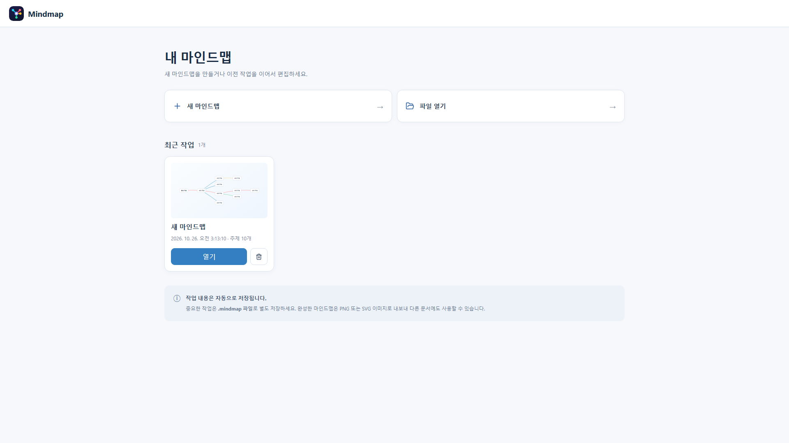
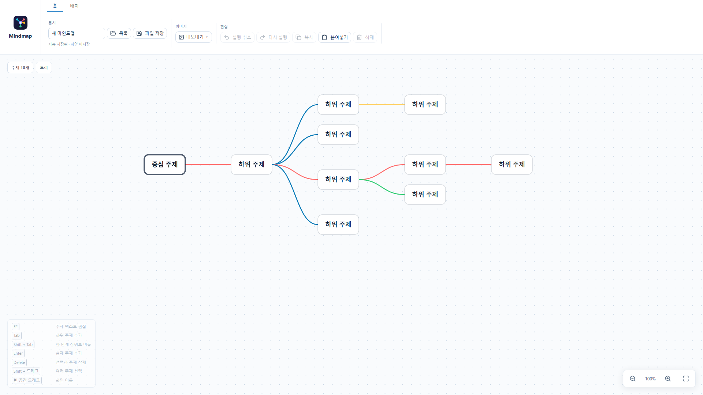

# Mindmap

생각과 아이디어를 자유롭게 연결하고 정리할 수 있는 브라우저 기반 마인드맵 편집기입니다.

별도의 설치나 계정 없이 마인드맵을 만들고, 완성한 작업을 `.mindmap` 파일 또는 PNG·SVG 이미지로 저장할 수 있습니다.





---

## 소개

이 프로젝트는 떠오르는 생각을 빠르게 시각화하고, 주제 사이의 관계를 직관적으로 편집할 수 있도록 만든 웹 기반 마인드맵 도구입니다.

PowerPoint와 유사한 상황별 리본 메뉴를 통해 선택한 주제나 연결선에 필요한 도구를 표시하며, 키보드 단축키와 마우스 조작을 함께 지원합니다. 작업 내용은 브라우저에 자동 저장되고, 중요한 문서는 파일로 별도 보관할 수 있습니다.

주요 목표:

* 별도의 설치나 회원가입 없이 바로 사용할 수 있는 편집 환경
* 주제 추가·이동·선택·꾸미기를 위한 일관된 조작 방식
* 트리·방사형·밑줄 배치와 개별 연결선 서식 지원
* 브라우저 자동 저장과 독립적인 문서 파일 백업
* 다른 문서나 발표 자료에서 활용할 수 있는 이미지 출력

---

## 목차

1. [주요 특징](#주요-특징)
2. [사용 기술](#사용-기술)
3. [접속 및 실행 방법](#접속-및-실행-방법)
4. [사용 방법](#사용-방법)
5. [단축키 및 편의 기능](#단축키-및-편의-기능)
6. [데이터 저장 및 주의 사항](#데이터-저장-및-주의-사항)
7. [개발자 가이드](#개발자-가이드)
8. [License](#license)

---

## 주요 특징

* **상황별 리본 메뉴:** 선택한 주제 또는 연결선에 따라 관련 편집 도구를 상단에 표시합니다.
* **다양한 배치 방식:** 트리, 방사형, 밑줄 레이아웃과 재배치 기능을 지원합니다.
* **자유로운 편집:** 드래그 이동, 격자 스냅, 다중 선택, 선택 항목 일괄 서식 변경을 지원합니다.
* **연결선 꾸미기:** 연결선별 색상, 굵기, 직선·곡선 형태를 조절할 수 있습니다.
* **자동 저장:** 브라우저에 작업 내용을 저장하고 최근 문서를 로비에서 다시 열 수 있습니다.
* **문서 백업:** `.mindmap` 파일로 저장하고 다시 불러올 수 있습니다.
* **이미지 내보내기:** PNG(투명 또는 지정 배경색)와 SVG 형식으로 출력할 수 있습니다.
* **여러 탭 변경 감지:** 같은 문서를 여러 탭에서 열었을 때 저장 상태 변경을 감지하고 충돌 시 덮어쓰기를 방지합니다.

---

## 사용 기술

### Frontend (Static Web)

* React 19
* TypeScript 5
* Vite 6
* CSS / SVG
* Lucide React (아이콘)

### Browser APIs

* IndexedDB (문서 자동 저장)
* BroadcastChannel (브라우저 탭 간 변경 알림)
* File API 및 브라우저 파일 저장 기능

### Hosting / Deployment

* Cloudflare Pages 등 정적 웹 호스팅
* 별도의 애플리케이션 백엔드 및 데이터베이스 서버 불필요

---

## 접속 및 실행 방법

### 1. 웹 서비스로 이용하기

배포된 웹사이트에 접속하여 **새 마인드맵**을 만들거나 `.mindmap` 파일을 열어 작업할 수 있습니다.


### 2. 로컬 개발 환경

Node.js 및 npm이 설치된 환경에서 다음 명령을 실행합니다.

```bash
npm install
npm run dev
```

### 3. 프로덕션 빌드

```bash
npm run lint
npm run build
npm run preview
```

빌드 결과물은 `dist/` 폴더에 생성됩니다.

---

## 사용 방법

1. 로비에서 **새 마인드맵**을 선택하거나 기존 문서를 엽니다.
2. 중심 주제에서 하위 주제와 형제 주제를 추가합니다.
3. 주제를 드래그하여 배치하고, 상단 **주제** 탭에서 색상·도형·글꼴을 변경합니다.
4. 연결선을 선택해 색상·굵기·형태를 수정합니다.
5. **배치** 탭에서 레이아웃을 변경하거나 재배치합니다.
6. **홈** 탭에서 `.mindmap` 파일로 저장하거나 PNG·SVG 이미지로 내보냅니다.

---

## 단축키 및 편의 기능

| 조작 | 기능 |
|---|---|
| `Tab` | 하위 주제 추가 |
| `Shift + Tab` | 선택한 주제를 한 단계 상위로 이동 |
| `Enter` | 형제 주제 추가 |
| `F2` | 선택한 주제의 텍스트 편집 |
| `Delete` / `Backspace` | 선택한 주제 삭제 |
| `Ctrl + Z` / `Ctrl + Y` | 실행 취소 / 다시 실행 |
| `Ctrl + C` / `Ctrl + V` | 복사 / 붙여넣기 |
| `Ctrl + S` | `.mindmap` 파일 저장 |
| `Ctrl + 휠` | 확대 / 축소 |
| `Ctrl` 또는 `Shift` + 클릭 | 다중 선택 |
| `Shift` + 빈 공간 드래그 | 영역 선택 |
| 빈 공간 드래그 | 화면 이동 |

연결선도 `Shift` 또는 `Ctrl`을 누른 채 클릭해 여러 개를 선택하고 공통 서식을 적용할 수 있습니다.

---

## 데이터 저장 및 주의 사항

* 편집 중인 문서는 사용 중인 브라우저의 **IndexedDB**에 자동 저장됩니다.
* 브라우저 데이터 삭제, 시크릿 모드 사용 또는 기기 변경 시 저장된 문서를 이용하지 못할 수 있습니다. **중요한 작업은 반드시 `.mindmap` 파일로 별도 보관하세요.**
* `.mindmap` 파일은 JSON 기반의 자체 문서 형식이며, 다른 마인드맵 프로그램의 동명 확장자와 호환된다는 의미는 아닙니다.
* PNG 및 SVG는 문서 삽입용 출력 형식으로, 편집 가능한 원본을 보관하려면 `.mindmap` 파일을 사용해야 합니다.
* 여러 브라우저 탭 간 변경 감지는 지원하지만, 여러 사용자가 동시에 편집하는 온라인 협업 서비스는 아닙니다.

---

## 개발자 가이드

### 프로젝트 구조

```text
├── public/           # 파비콘 등 정적 리소스
├── src/
│   ├── main.tsx      # 편집기 UI 및 상호작용
│   ├── model.ts      # 마인드맵 문서 모델
│   ├── storage.ts    # 브라우저 저장 및 동기화
│   ├── thumbnail.tsx # 최근 작업 미리보기
│   └── style.css     # 스타일
├── docs/
│   ├── lobby.png     # 로비 스크린샷
│   └── editor.png    # 에디터 스크린샷
├── index.html
└── package.json
```

### Cloudflare Pages 배포

Git 저장소를 연결한 후 다음과 같이 설정합니다.

| 항목 | 값 |
|---|---|
| Build command | `npm run build` |
| Build output directory | `dist` |
| Root directory | 프로젝트 루트 |

`dist/`는 빌드할 때 생성되므로 일반적으로 Git 저장소에 포함하지 않습니다. Cloudflare가 빌드 결과를 배포합니다.

---

## License

MIT License.
